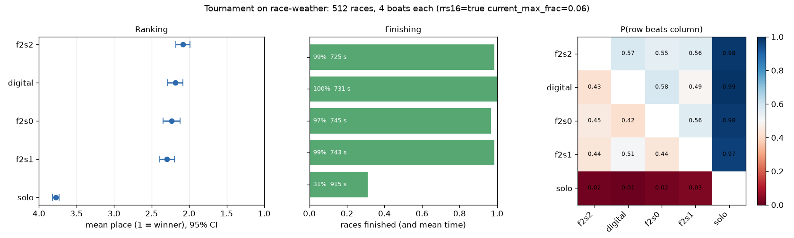
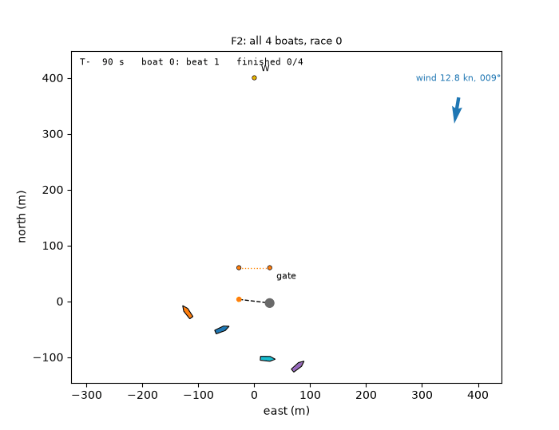
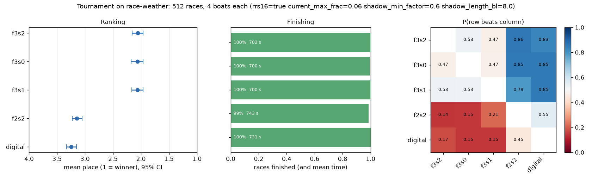
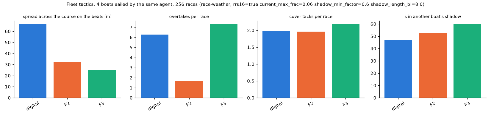
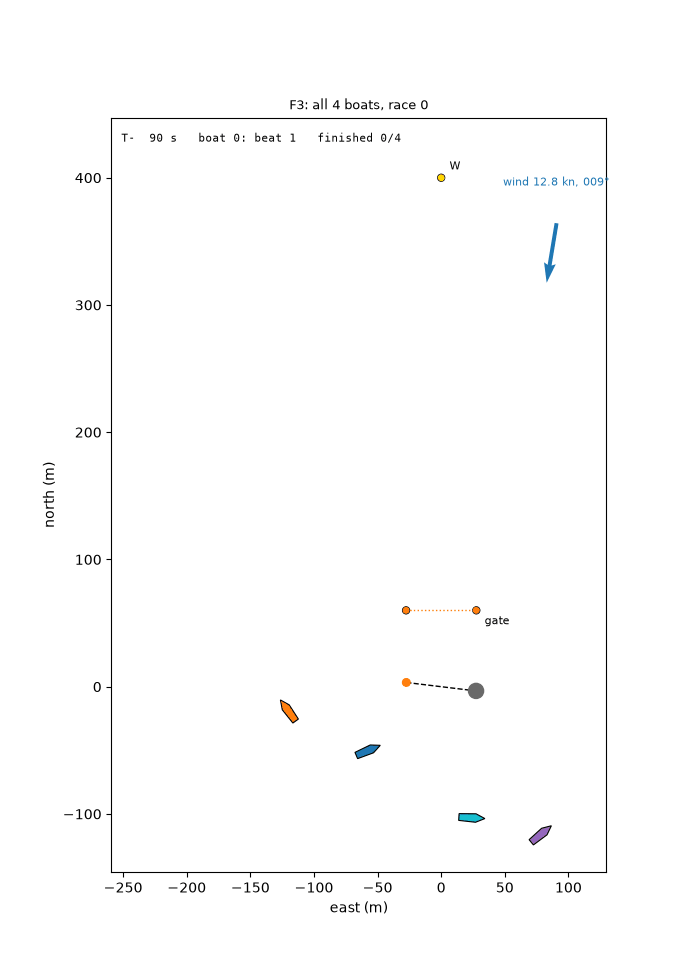
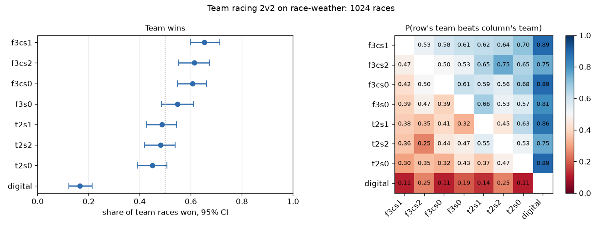
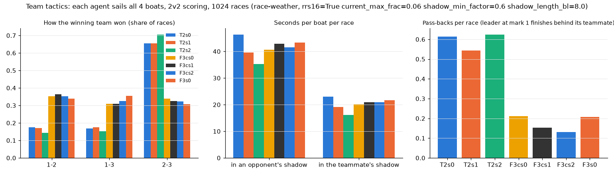
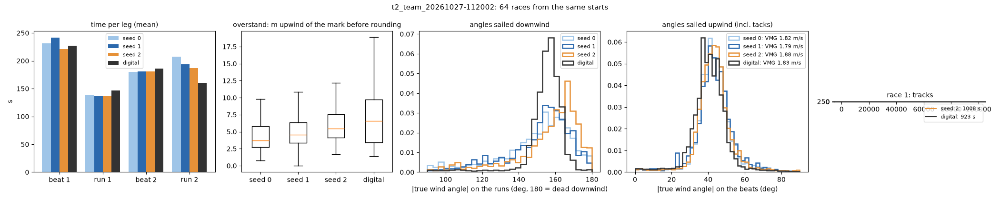
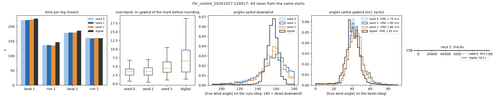
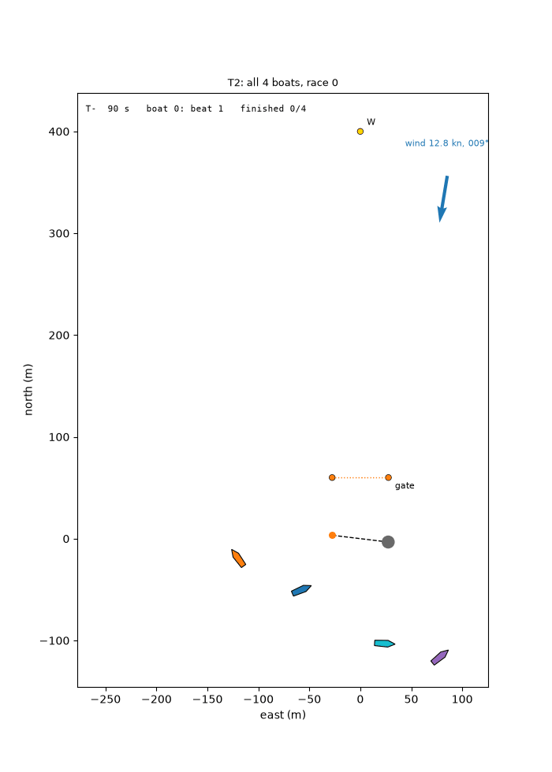

# Fleet and team racing: what happened (2026-10-26/27)

> An honest record of the first two days of 4-boat fleet racing and 2v2 team racing, for both the training
> and the environment, including what did not work. Continues [writeup_racing.md](writeup_racing.md) (one boat
> alone on the course). All numbers are from greedy races (most likely action) with fixed race seeds.

## Summary

- **Fleet racing works, team racing does not (yet).** Starting from the solo weather racer, four boats trained
  together reach a mean place of **2.06** (of 4) in mixed fleets against the digital racer (3.25) and the
  previous fleet agent (3.14), finishing 99.5% of races (F3). Trained for the team result instead (T2), the
  same boats got **worse**: T2 teams lose 63–69% of team races to a control trained the same amount for their
  own place, and T2 is a worse racer on every measure.
- **The pre-registered test said "partial" at best, and the honest reading is "no team tactics".** The two
  behaviour measures that moved (more pass-backs, slower winners) are also what a worse racer produces; the
  one that would show deliberate team play (sailing to put opponents in dirty air) did not move.
- **Real tactics are still missing in fleet racing too.** F3 boats overtake as often as the digital racers
  (7.3 vs 6.3 order swaps per race), but they sail **closer together** than ever (25 m spread across the
  course vs the digital racers' 66 m) and spend more time in each other's dirty air. They do not split.
- **The environment caused two of the failures.** A rule bug let boats cut the leeward gate (F1 and T1 were
  invalid), and a contact cost equal to the whole spread of places made avoiding other boats worth more than
  any pass (F2's procession). Both are fixed. A third environment issue is still open: **the sides of the
  course differ too little to make splitting pay** (see [Next steps](#7-next-steps)).

| Run | What changed | Result | Verdict |
|---|---|---|---|
| F0 | solo racer dropped into a 4-boat fleet | place 2.6–3.0, 75–81% finished, ~3 penalties per race | solo skills do not transfer to traffic |
| F1 | 4-boat self-play from the solo racer, RRS 16 on | place 2.06–2.29 vs digital 2.51 | **invalid**: boats cut the leeward gate (env bug) |
| T1 | 2v2 team racing from F1 | team wins 38–55% | **invalid** (same bug) |
| F2 | gate fixed; weather; opponent pool; time cost phased out | place 2.09–2.29 vs digital 2.18: a tie | a procession: 1.2–1.7 overtakes per race |
| F3 | contact cost 2.0 → 0.25; stronger wind shadow; varied opponents; place only | place 2.06 vs digital 3.25 | **works**; overtakes 7.3, but no splitting |
| T2 | F3 + team scoring, +300M steps | loses 63–69% of team races to F3c | **no team tactics**; worse racer |
| F3c | F3 + individual scoring, +300M steps (control) | slightly better than F3 | extra training alone helps a little |

---

## 1. Setup

- **Race:** the windward-leeward course of [writeup_racing.md §1.1](writeup_racing.md#11-the-course-and-the-race)
  (400 m beats, leeward gate, 2 laps), **4 boats**, sail_env's racing rules (right of way, contact, mark-room,
  penalty turns) plus RRS 16 (a right-of-way boat that changes course into a contact takes the penalty).
  From F2 on: weather (shifts, puffs, a pressure gradient, current capped at 6% of the wind, waves).
- **Reward (F3 form):** +1 for finishing, then a zero-sum place reward (winner +1 … last −1), −0.25 per contact
  (−0.1 for the right-of-way boat), −1 for a penalty still owed at the end, and progress shaping that is phased
  out by 50% of training. No time cost: only the place counts. **Team racing** pays every boat its *team's*
  result instead (lower sum of places wins; a tie goes to the team without first place, RRS Appendix D), and
  each boat sees which neighbours are teammates (5 more inputs).
- **Training:** PPO from sail_env, 2048 races × 4 boats in parallel on one RTX 4090 (Runpod), 300M steps per
  seed, 3 seeds, ~40 minutes per run. One shared network sails every learning boat (self-play). From F2 on,
  a share of races put boats 2–3 in the hands of an **opponent pool**: frozen snapshots of the learner, the
  digital racer and (F3, T2) the F2 seeds.
- **Evaluation** (scripts in `experiments/`):
  - `tournament.py`: mixed fleets of different agents, mean place with a 95% CI and head-to-head win rates;
    with `--teams`, each race is one agent's team against another's.
  - `fleet_tactics.py`: all four boats sailed by the same agent; spread across the course on the beats,
    order swaps after the first mark, cover tacks, seconds in another boat's shadow.
  - `team_tactics.py`: the same in 2v2 team races; winning combinations, pass-backs, whose shadow boats sail in.
  - `diagnose_race.py`: one boat alone against the digital racer (the solo time trial of the racing write-up).

## 2. From solo racer to fleet racer (F0–F2)

**F0, the solo racer in a fleet.** The bundled `rl-racer` was trained alone. In a 4-boat fleet it never
learned shadow, right of way or crowded roundings: mean place 2.6–3.0 against the digital racer's 1.59, only
75–81% of races finished, ~3 penalties per race.

**F1, self-play.** Four copies of the racer trained together for 200M steps beat the digital racer (2.06–2.29
vs 2.51) and fixed the finishing (99%). Then the GIFs showed two things the numbers had not: the boats
**cut through the leeward gate** without rounding a mark, and they **followed each other** round the course.
The first was a bug in the environment (§5.1); it made F1, and the team run T1 built on it, invalid.

**F2, after the fix.** The solo racers were retrained under the corrected gate rule (steady wind 21–24 s,
weather 26–28 s faster than the digital racer per race, which also rounds the gate clumsily), and fleet
training restarted from the weather racer, with an opponent pool (half the races against frozen snapshots and
the digital racer) and the time cost phased out, so at the end only finishing and place paid.

F2 tied the digital racer (mean place 2.09–2.29 vs 2.18, overlapping CIs) and sailed **in a procession**:
1.2–1.7 order changes per race against the digital racers' 6.5.

The cause was in the reward, not the learner: a contact cost 2.0 per boat (the fleet preset's value from the
start-line work), **as much as the whole difference between first (+1) and last (−1)**. Staying away from
other boats was worth more than any pass, so the safe policy was to sail behind.

## 3. F3: a fleet that races

Decided with the user: only the result counts (no time cost at all), contacts cost 0.25 (0.1 for the
right-of-way boat), a stronger wind shadow (down to 60% of the wind, 8 boat lengths long; was 75%, 6), and a
more varied pool (in 75% of races boats 2–3 each drawn separately from the snapshots, the digital racer and
the three F2 seeds).

| Mixed 4-boat fleets, 512 races, weather | Mean place [95% CI] | Finished | Penalties / race |
|---|---|---|---|
| **F3, seeds 0 / 1 / 2** | **2.06 / 2.06 / 2.06** [1.96, 2.17] | 99.5–99.8% | 0.62–0.75 |
| F2 (best seed) | 3.14 [3.05, 3.23] | 98.5% | 0.71 |
| digital racer | 3.25 [3.15, 3.33] | 100% | 0.76 |

F3 beats the digital racer head-to-head in 83–85% of boat pairs. Caveat: F3 trained against both of these
opponents (they are in its pool), so part of the margin may be specific to them. It has not yet raced an
opponent it never met.

| All four boats the same agent, 256 races | Spread across the course | Order swaps / race | Cover tacks / race | s in dirty air / boat |
|---|---|---|---|---|
| digital racer | **66 m** | 6.3 | 2.0 | **47** |
| F2 | 32 m | 1.7 | 2.0 | 53 |
| F3 | 25 m | **7.3** | 2.2 | 60 |

The procession is broken, but read the other columns: F3 boats sail **closer together** than F2 and spend
**more** time in dirty air. More order swaps in a tight pack is churn as much as tactics. Splitting from the
fleet to find a better side, the most basic fleet tactic, has not appeared, and §5.3 argues the environment
gives it too little reason to.

## 4. Team racing: T2 and the control F3c

**The question:** with the same boats, physics and opponents, does changing only the score (own place → team
result) produce team-racing tactics: pass-backs, slowing an opponent to promote a teammate, mark traps?

**The test was written down before any T2 result was seen**
([team_racing_criteria.md](team_racing_criteria.md)), with a control F3c: F3 trained for the same extra 300M
steps for its own place, so "more training" and "team objective" can be told apart.

| | seed 0 | seed 1 | seed 2 | Holds? |
|---|---|---|---|---|
| **H1:** T2 team beats F3c team (1024 team races) | 37% | 35% | 31% | **no**: T2 loses |
| H1b: individual place, T2 / F3c | 2.81 / 1.97 | 2.90 / 1.95 | 2.89 / 2.12 | yes, because T2 is worse |
| H2a: pass-backs per race, T2 / F3c | 0.61 / 0.21 | 0.54 / 0.15 | 0.62 / 0.13 | yes |
| H2b: puts opponents rather than the teammate in dirty air | 1.01 / 1.01 | 1.03 / 1.03 | 1.10 / 0.99 | **no** (no preference) |
| H2c: race winner's time (s), T2 / F3c | 729 / 682 | 722 / 683 | 717 / 686 | yes |

**What this means.**
- By the rules fixed in advance the verdict is *partial* (behaviour measures only). But T2 is worse than F3c on
  every measure of racing: alone on the course it is 25–50 s slower (731–755 s vs 704–706 s; the digital
  racer: 725 s), in individual fleets it places 2.8–2.9 vs 2.0–2.1, and it collects more penalties (0.77–0.82
  vs 0.62–0.65 per race) and contacts. A slower, sloppier fleet also produces more pass-backs and slower
  winners, so H2a and H2c do not show tactics. The measure that would (H2b, sailing to put opponents in dirty
  air) did not move. **No team tactics emerged; team scoring made the racer worse.**
- The control was worth running: F3c got slightly *better* than F3 (team races 61–65% vs F3's 55%), so the
  decline comes from the team objective, not from extra training.

| T2 alone vs the digital racer | F3c alone vs the digital racer |
|---|---|
|  |  |

**Unexplained so far.** In T2's own races, the winning boat's teammate finishes **last in 65–70%** of races
(F3c: 32–34%, about what chance gives). Team training pulls teammates apart in the results. A likely cause,
not yet checked, is the *credit assignment* (or "lazy agent") problem of cooperative multi-agent RL: both
teammates get the same team reward whatever each did, so one boat's own sailing barely changes its reward and
it can stop trying without being punished. A second factor: three quarters of T2's training races were
against the F2 seeds and the digital racer, weaker than the F3c teams it was tested against.

## 5. The environment: what it got wrong, and what it still lacks

### 5.1 Bugs found by watching the races

| Problem | How it showed | Fix (sail_env) |
|---|---|---|
| **The leeward gate could be cut**: crossing the gate line between the marks completed the run, so boats sailed through and on, never rounding a mark | F1 GIFs | sail-env 0.2.0: the boat must pass through and then round one gate mark (up its outside); the digital racer rounds it too. F1, T1 and the solo racers retrained |
| **Close finishes tied**: ranks came from a float32 score 1e7 − t, which cannot tell times < 1 s apart | tied places in fleet results | sail-env 0.2.0: exact ranking |
| **Team racing + weather: teammate flags in the wrong place**: widening a weather network for team racing appended the 5 new inputs after the weather block, so the teammate flags would have taken the weather weights | first T2 start failed (team-blind opponents were refused) | sail-env 0.2.0: the team block sits before the weather block |
| A team-trained network could not sail an individual race | needed for the T2 control comparison | sail-env 0.2.0: the loader gives it all-zero teammate flags (with a test) |

The two that mattered most (the gate, and the contact cost of §2) were found in the GIFs, not in the
metrics: every aggregate number for F1 looked like success.

### 5.2 Settings that shaped the results

- **Contact cost 2.0**, inherited from the start-line work where it cut contacts, was the cause of F2's
  procession: in a race it outweighs the whole place reward. It is still the preset default; fleet-racing
  configs now set 0.25.
- **Wind shadow** is a geometric cone (§5.4 of sail_env's ENVIRONMENT.md). F3 made it stronger (60% of the
  wind, 8 boat lengths). It is a design choice, not a measurement.

### 5.3 What it still lacks: a reason to go the other way

In real fleet racing boats split because the sides of the course differ in ways the sailors cannot fully
know in advance: a persistent shift, more pressure on one side, less adverse current near the shore. The
leaders cover; the boats behind take a risk on the other side, because following can never get them past.

sail_env's weather has these ingredients, but small:

- a pressure gradient of at most ±4% of the wind per 100 m across the course;
- a geographic bend of at most ±2° per 100 m;
- a persistent drift of at most ±6° per 10 minutes;
- a uniform current (the same everywhere, so it cannot favour a side).

Most of what changes the wind is short puffs and oscillating shifts that the boats can see coming (22 weather
inputs). Nothing has been measured yet about how much choosing the right side is worth in a typical race, but
the agents' behaviour suggests not much: the digital racers spread 66 m because they are hand-written to
sail to the laylines, and every learned fleet has sailed in a tighter pack than that. See
[Next steps](#7-next-steps).

### 5.4 Not modelled, and relevant to team racing

- Team racing rules beyond the scoring (e.g. no Appendix D umpire calls, no penalty for contact between
  teammates beyond the normal cost).
- Proper course, luffing rights after an overlap from clear astern, room to tack at a mark (RRS 17, 18.3).
  Several classic team-racing moves depend on them.
- Only 4 boats: real team racing is mostly 3v3 or 4v4, where the combinations are richer.

## 6. Assessment

- **Solid:** the measuring. Pre-registration, a control run, fixed race seeds, paired comparisons and 95%
  intervals caught a result that would otherwise have read as a success twice (F1's numbers; T2's pass-backs).
- **New, as far as the literature search went:** none of the RL work on sailing found (single-boat control,
  routing, America's Cup simulation) covers learned fleet or team racing. The *question* is new; the results
  so far are a working fleet racer and a negative team-racing result.
- **Not new:** the methods (PPO, self-play, opponent pools, kickstarting, curricula).
- **Weak spots:** F3's margin is measured against opponents it trained with; every finding is "in this
  simulator", whose rules and wind shadow are simplified; 3 seeds per run.
- **The most useful thing so far** may be the environment itself: a fast JAX fleet/team racing simulator with
  rules, weather, baselines and a browser front end, which does not exist elsewhere.

## 7. Next steps

**Environment (sail_env)**
1. **Measure how much the side matters.** Race the digital racer forced to the left vs the right side on the
   same races; report the time difference per beat. This is the number that says whether splitting can pay.
2. **More, and less predictable, difference between the sides.** Larger persistent features (pressure
   gradient, geographic bend, drift), a current that varies across the course, and a per-race "which side is
   favoured" that the boats can only partly see (a noisy forecast, revealed as the beat goes on), so that
   going the other way is a real gamble with a real payoff. Behind flags, standard presets unchanged.
3. Team-racing rules that the classic moves depend on (proper course, luffing rights), and 3v3.

**Training**
1. Explain T2's 1-4 pattern on the laptop (no GPU): what the last boat does in T2's own races (penalties,
   dirty air, slow legs, sailing off).
2. If it is credit assignment: a mixed reward (own place + a team bonus that ramps up from 0), so each boat
   keeps a personal learning signal while the team incentive grows.
3. Train team agents against strong team opponents (F3c teams in the pool), not mainly F2 and the digital racer.
4. Test F3/F3c against opponents they never met (held-out seeds, humans in the browser game).
5. Two cheap ablations for the write-up: F3 with contact cost 2.0 (only that changed), and F3 without the
   stronger shadow.

## 8. Runs

| Run (runs/train/…) | What |
|---|---|
| f1_selfplay_20261026-132023, t1_team_20261026-145455 | F1, T1 (invalid: gate bug) |
| gpu_racer_gate_20261026-154813, gpu_weather_gate_20261026-162541 | solo racers retrained under the gate fix (bundled) |
| f2_weather_league_20261026-170806 | F2 |
| f3_aggressive_20261027-100113 | F3 |
| t2_team_20261027-112002 | T2 |
| f3c_control_20261027-120017 | F3c (control) |

Evaluation outputs: `runs/tournament/{f0_baseline,f1,t1,f2,f3,t2_vs_f3c_s0..2,t2_teams,t2_individual}`,
`runs/fleet_tactics/{f2,f3,t2}`, `runs/team_tactics/t2`. Configs: `experiments/configs/fleet/`. Evaluation
conditions for F3 and later: `--env race-weather --set rrs16=true current_max_frac=0.06 shadow_min_factor=0.6
shadow_length_bl=8.0`. GPU cost on 2026-10-27 (F3, T2, F3c and their evaluation): ~$2.85 (3.2 h at $0.89/h).
