# Teaching a J/70 to race: from a boat that parks to one that beats the hand-written racer

> **DRAFT, detailed version** (2026-10-26), written to be cut down. It records every step of the racing
> work, including the dead ends, with the numbers, figures and GIFs behind each claim. Companion to
> [writeup_starts.md](writeup_starts.md) (the start). Items marked **TODO** are open decisions or checks.

> **Correction (2026-10-27).** Sections 2–6.3 were measured under a rule bug found later in the fleet work:
> crossing the leeward gate line between the marks completed the run, so a boat did not have to round a gate
> mark. The bundled racers were retrained under the fixed rule (§6.4). Their margins over the digital racer
> grew (steady −24 / −22 / −21 s, weather −28 / −28 / −26 s), partly because the digital racer rounds the gate
> clumsily, so the larger margins overstate the learned racers' skill. Fleet and team racing:
> [writeup_fleet_team.md](writeup_fleet_team.md).

## Summary

- **Task:** sail a full windward-leeward race (beat, run, beat, run to the finish; 400 m beats) alone on the
  course, in the [sail_env](https://github.com/tringermate/sail-env) J/70 simulator, as fast as possible.
  Every race starts just after the gun, from a bank of 4096 starts sailed by the bundled RL start policy.
- **Reference:** the *digital racer*, a hand-written controller in sail_env that sails the polar's best
  VMG angles, tacks/gybes on the laylines and rounds the marks. It finishes every race, in 672.7 s on our
  64 test starts in steady wind and 684.7 s in weather.
- **Result:** learned racers now beat it clearly, in steady wind **and** in weather:

| Racer | Conditions | Finished | Paired difference to the digital racer, seeds 0 / 1 / 2 (95% CI) |
|---|---|---|---|
| Pure PPO, racing ladder (laptop) | steady | 100% | +57.8 / +42.7 / +10.6 s (all slower) |
| **Kickstarted from the digital racer** (laptop) | steady | 100% | −2.6 [−6.0, +0.4] / **−9.9** [−12.9, −7.2] / **−5.7** [−8.8, −2.8] s |
| **Kickstarted, 2048 envs on a GPU** | steady | 100% | **−7.9** / **−11.0** / **−3.0** s (all CIs below 0) |
| **W5b: weather racer, 2048 envs on a GPU** | weather | 100% (1 DNF in 768) | **−19.2** [−21.1, −17.4] / **−14.7** [−18.0, −9.9] / **−14.9** [−17.0, −12.7] s |
| *After the gate fix (§6.4):* steady racer, retrained (bundled `rl-racer`) | steady | 100% | −24.1 / −21.6 / −20.7 s (all CIs below 0) |
| *After the gate fix:* weather racer, retrained (bundled `rl-racer-weather`) | weather | 100% | −28.3 / −27.8 / −25.6 s (all CIs below 0) |

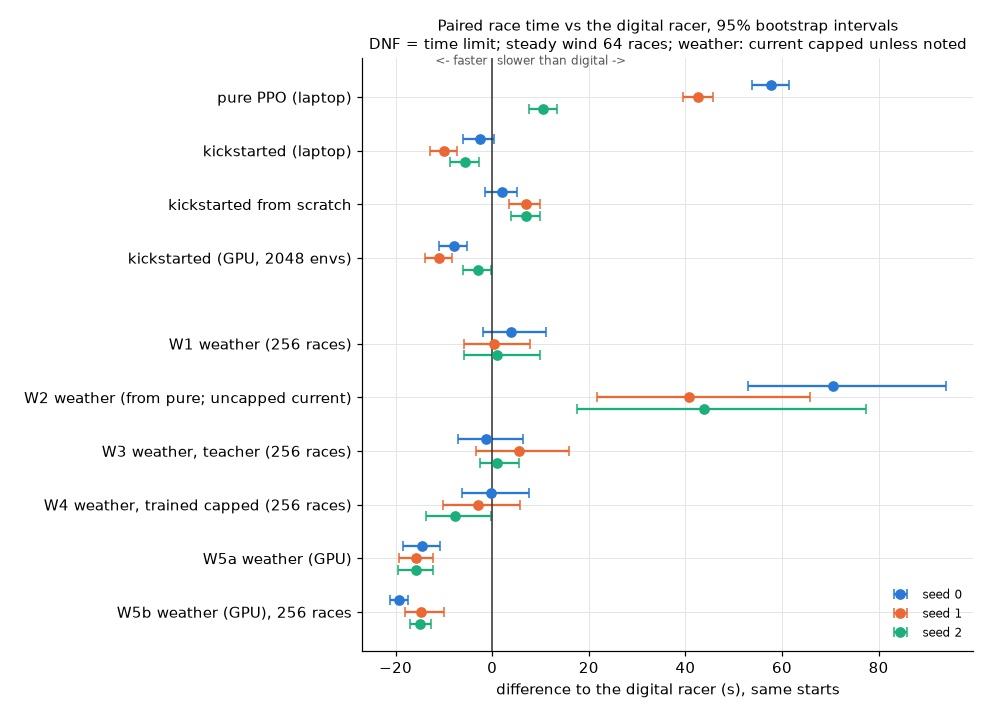

- **What made the difference**, in order: (1) a reward that does not pay a boat for parking; (2) a ladder
  of shorter courses; (3) **kickstarting**, an imitation term towards the digital racer that fades to zero,
  after which RL improves past its teacher; (4) a "race committee" rule removing conditions no race officer
  would start a race in; (5) **scale**: 2048 races in parallel and 200M steps per seed on one rented GPU
  (about 23 minutes and $0.35 per run).

**TODO:** the one-paragraph "why this matters beyond sailing" (long horizon, sparse finish, a strong
hand-written expert to start from; learned policy surpasses the expert).

---

## 1. Setup

### 1.1 The course and the race

- Windward-leeward, 4 legs: beat 400 m to the windward mark (leave it to port), run through a leeward gate
  (60 m upwind of the start line), beat, run to the finish line (the start line). `race_legs: 4,
  course_beat_length: 400, gate_offset: 60`.
- A rounding counts only when the boat crosses the half-line straight upwind of the mark from right to left
  (port rounding), and the gate only when the boat passes between its marks going downwind.
- Time limit: 1200 s after the gun (`t_end`). Light-wind races take ~15 minutes.
- Physics, polar, actions (7 discrete: hold, ±5°, ±15°, tack/gybe, luff) as for the start
  ([writeup_starts.md](writeup_starts.md#the-simulator)).
- **Observation:** 72 features: the boat's own state, the 5 nearest boats (empty when racing alone), plus
  the course in the boat's frame: windward mark, both gate marks, the line centre, the leg, a beat/run flag.
  With weather: 22 more (the wind the boat saw 10–60 s ago, the wind at 6 points 100–250 m upwind, the
  current, the waves): 94 features.
- **Starts:** a bank of 4096 race states just after the gun, produced by sailing the start with the bundled
  fleet start policy (`start_bank`), sampled uniformly. 96–98% of boats have started cleanly.

### 1.2 The learner

PPO from sail_env (`sail_env/train/ppo.py`, the same one-file PureJaxRL-style implementation as for the
starts): 2×128 tanh MLP actor and critic, 3 seeds trained in parallel with `vmap`, Adam with linearly
decaying learning rate, entropy coefficient decaying linearly to its final value, GAE.

On the laptop (CPU): 64 envs × 256 steps per update (16,384 steps), 8 minibatches, 4 epochs.
On the GPU: 2048 envs × 64 steps (131,072 steps), 32 minibatches, 4 epochs.

### 1.3 The reward (final form)

Per boat and second:

```
r = -1/600                                  # time cost while racing (a 700 s race costs ~1.17)
  + 1 at the finish
  + 0.1 x (Phi(s') - Phi(s))                # shaping, Phi = -(distance still to sail by the rounding route) / 100 m
```

with discount γ = 0.999 and **undiscounted** shaping (`shaping_gamma: 1`). Section 2 explains why each of
these settings is there.

### 1.4 How racers are judged

Training curves use the policy's sampled actions. All numbers in this document are from
`experiments/diagnose_race.py`: greedy races (most likely action) from 64 (or 256) starts of the start bank,
**paired** with the digital racer from the same starts. Per racer it reports leg times, beat angles and VMG,
overstand at the windward mark, tacks/gybes per leg, run angles, and a **fair score**: every race counts,
an unfinished race scores the time limit (DNF), and the paired difference has a bootstrap 95% interval.

The fair score was added on 2026-10-25 after the weather racers looked faster than they were: averaging
only finished races hides the 2–8% of races they did not finish.

---

## 2. Agents A and B: plain PPO cannot get round the course (2026-10-21 to 10-23)

### 2.1 Agent A: shaped PPO on the full race

Config: `experiments/configs/race_a_shaped.yaml`. Reward as above but with γ = 0.997, shaping discounted
with the same γ, and Φ = −straight-line distance to the next mark.

**Outcome: never rounded a mark.** After 43M steps per seed its best 20-update average was 0.08 legs per
race. The boat learned to go upwind (zig-zagging, pinching) but arrived to the *left* of the windward
mark: straight-line distance gives no hint to go *round* it from the right. Changing Φ to the distance
along the **rounding route** (two boat lengths off the mark, then on to the next leg) got it there three
times sooner (T+300 s instead of ~1000 s), but still no roundings.

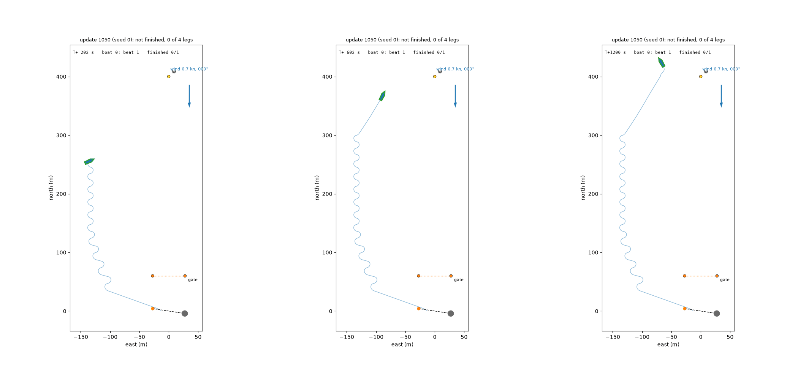

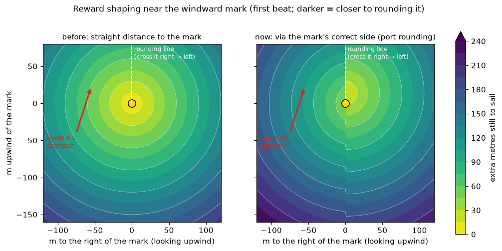

Agent A's network was lost when the session ended: the trainer only saved at the end of a run. Since then
it checkpoints every 100 updates (`checkpoint_every`), which saved a run twice later (sections 4 and 7).

### 2.2 Agent B: curriculum over starting situations, and the parking problem

Configs: `race_b_uniform.yaml`, `race_b_sfl.yaml`: agent A plus 75% of episodes starting anywhere on the
course (25% just after the start), sampled uniformly or by SFL.

**Outcome: two of three seeds parked in irons.** The reward made standing still pay:

1. With γ = 0.997, potential-based shaping adds (1 − γ)·|Φ| each second, and |Φ| is largest far from
   the finish: at 1,500 m to go, a *parked* boat earns **+0.0028 per second**, more than the time cost.
   Shaping is policy-invariant in theory, but PPO learns from what it sees second by second.
2. Discounting at 0.997 shrinks the finish: finishing in 700 s was worth only 0.17 more than parking until
   the time limit.

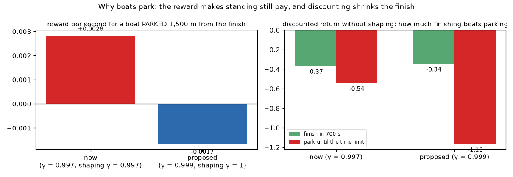

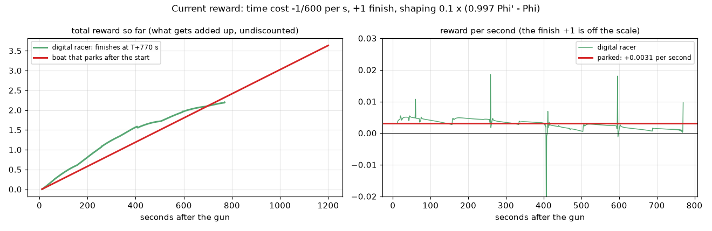

**Fix (config only):** `shaping_gamma: 1` (a parked boat now gets exactly the time cost, −0.0017 per second;
the shaping is then no longer strictly neutral, it nudges towards closing the distance, which is the
direction we want) and γ = 0.999 (finishing beats parking by 0.82 instead of 0.17).

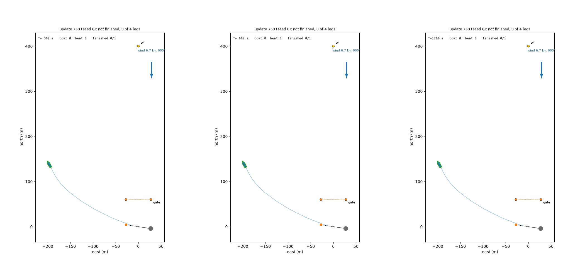

---

## 3. The racing ladder (2026-10-24)

Instead of the full race from scratch, a ladder: each stage starts from the previous stage's network and
moves on when the boats finish ≥ 80% of their races (`experiments/ladder.py`, configs in
`experiments/configs/ladder/`).

| Stage | Course | Steps per seed | Finished (training, last 5%) | Time (training) |
|---|---|---|---|---|
| 1 | beat 100 m, rounding finishes | 6M | 99.5–99.8% | 72–77 s |
| 2 | beat 400 m (tacking, laylines) | 25M | 99.5–99.6% | 221–228 s |
| 3 | beat + run through the gate | 25M | 99.7–99.8% | 360–381 s (digital: 339 s) |
| 4 | full race | 40M | 99.3–99.7% | 696–745 s (digital: 673 s) |

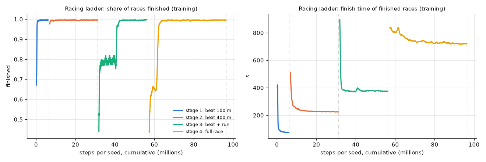

| Stage 1 | Stage 2 | Stage 3 |
|---|---|---|
| 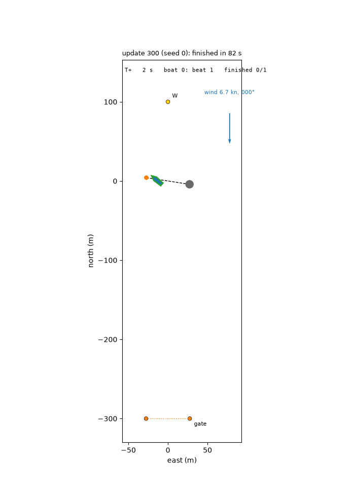 | 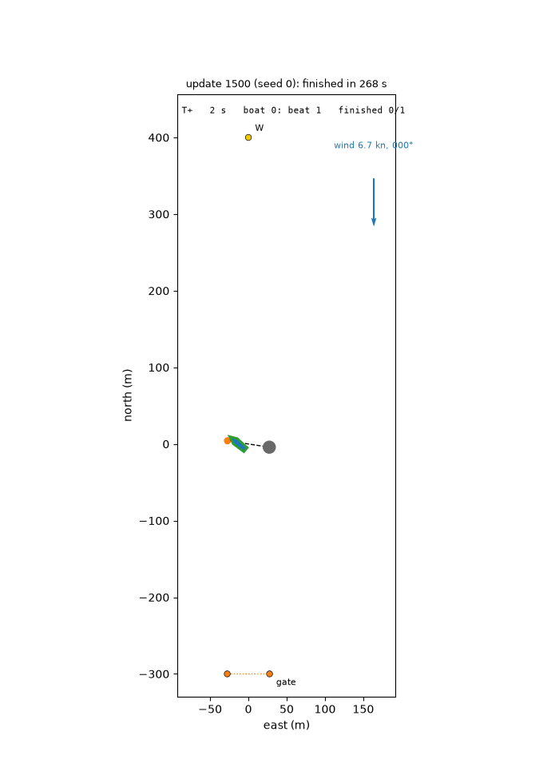 | 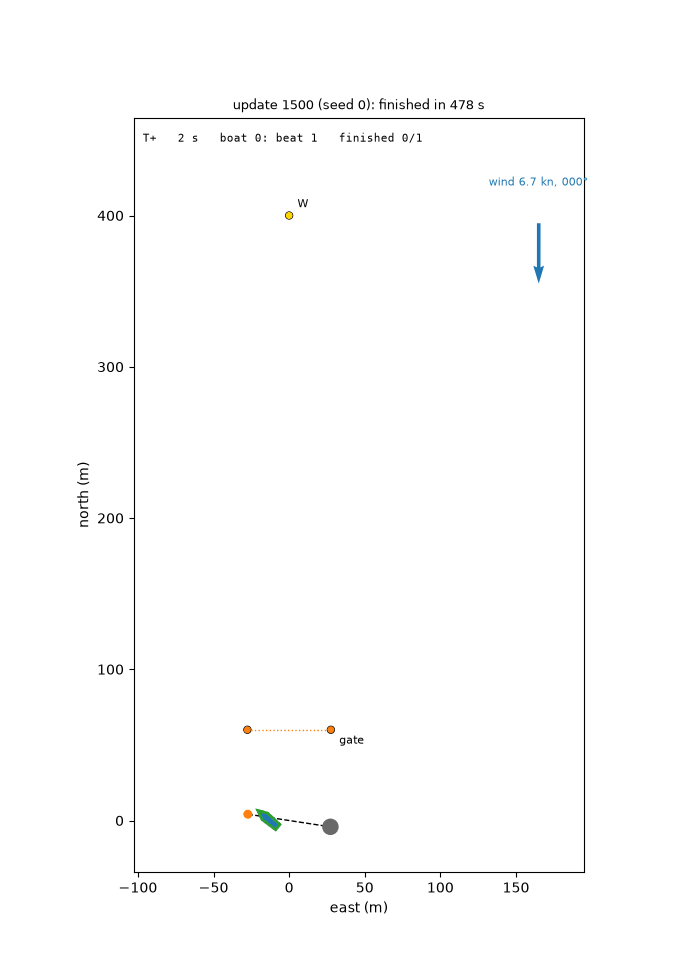 |

Stage 4 (pure PPO), the end of training:

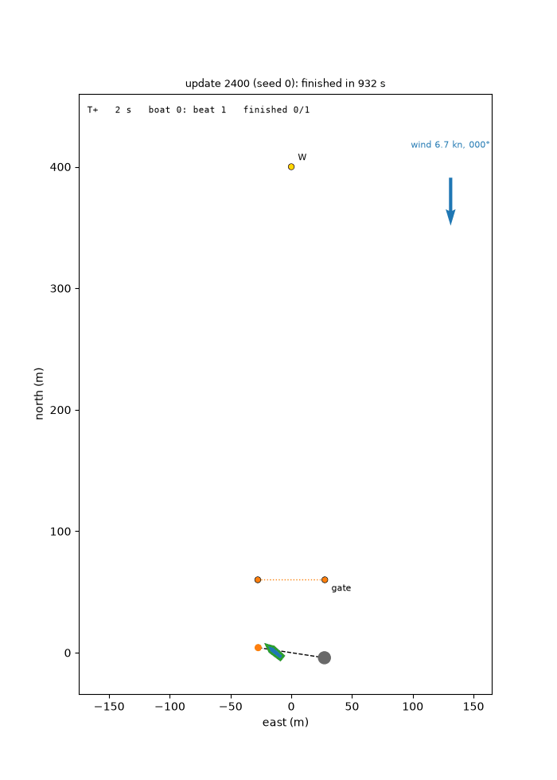

Notes:
- Stage 3 seed 0 stalled at ~80% finished for ~8M steps, then recovered by itself (updates 500–600).
- In greedy races (no sampling) stage 3 seed 0 still gets stuck in some races: fair score +521 s, while
  seeds 1 and 2 are +41 s and +18.5 s. **TODO:** decide whether to show this; it is a sampled-vs-greedy gap.
- **Stage 4 is competent but slow:** fair score +57.8 / +42.7 / +10.6 s vs the digital racer.

### 3.1 Where the time goes

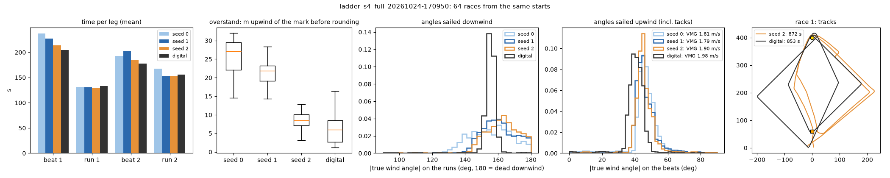

The loss was on the beats: the racers sailed ~45–50° to the true wind (digital: 41°), so their upwind VMG
was ~1.81 m/s against 2.01 m/s, and they overstood the windward mark by 9–27 m. The runs were as fast as
the digital racer's or faster.

---

## 4. Kickstarting: learn from the digital racer, then outgrow it (2026-10-24/25)

### 4.1 The method

Kickstarting (Schmitt et al., 2018): PPO plus an imitation term,

```
loss = PPO loss + kick(t) x CE( teacher action | the state the student is in )
kick(t) = kick_coef x max(0, 1 - progress / kick_until)          # 1 -> 0 over the first 30% of training
```

The teacher (the digital racer) is queried on the states the *student* visits (on-policy distillation,
like DAgger), so there is no compounding error from states the teacher would never reach. Once `kick`
reaches 0, it is plain PPO. Implemented in sail_env (`PPOConfig.kick_coef`, `kick_until`, config key
`teacher: digital`, any `load_agent` spec works), with `teacher_agreement` logged. Off by default; 4 tests
(`tests/test_kickstart.py`), including that a zero-weight teacher changes nothing.

Config: `experiments/configs/ladder/s4k_full_kick.yaml`: stage 4 identical to the pure run, from stage 3,
plus `teacher: digital, kick_coef: 1.0, kick_until: 0.3`.

### 4.2 Results

- Agreement with the teacher rose from 14% to 86% while the teacher was on. After `kick` reached 0 it **fell
  to ~47% while the times kept improving**: the student moved away from the teacher and got faster.
- The run was killed at update ~888 when Windows Application Control blocked all processes on the laptop;
  it was resumed from its update-800 checkpoint with the schedules continued (`s4k_resume.yaml`: lr =
  3e-4 × (1 − 800/2450), entropy continued, Adam state reset).

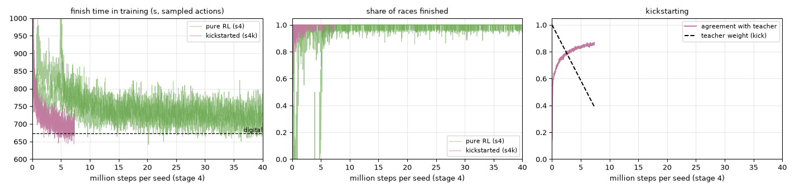

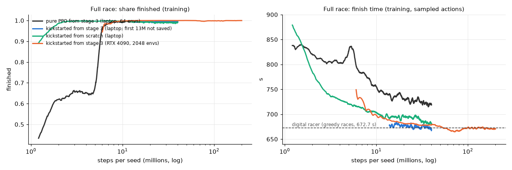

Fair score, 64 races: **−2.6 [−6.0, +0.4] / −9.9 [−12.9, −7.2] / −5.7 [−8.8, −2.8] s**: two of three seeds
clearly faster than the digital racer.

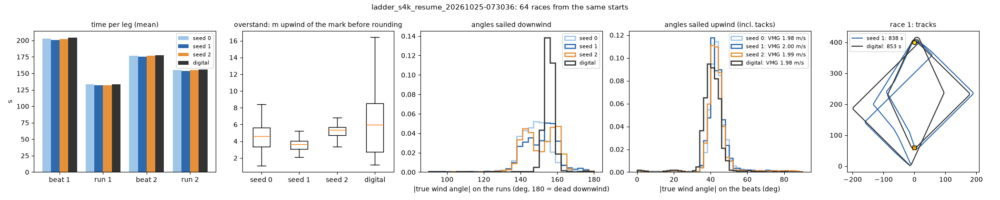

What changed against pure PPO:
- Beats at ~43° (pure: 45–50°, digital 41°) with the same VMG as the digital racer (1.98–2.00 m/s).
- Overstand 3.7–5.3 m (digital 6.0 m, pure 9–27 m).
- **Something the teacher does not do:** runs ~148–152° to the wind (digital: 155°), 1–2 s faster per run,
  and tighter mark roundings. Both appeared after the teacher's weight reached 0.

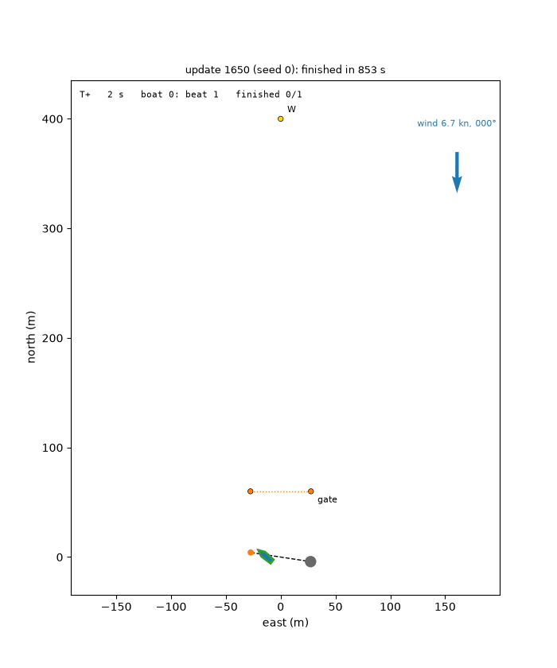

### 4.3 Kickstarting from scratch (no ladder)

`a1_kick_from_scratch.yaml`: random network, teacher, 40M steps. Finishes 100% (greedy), fair score
+2.1 / +6.9 / +7.0 s: within 1% of the digital racer but not past it. The ladder still helps.

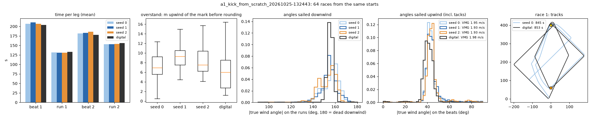

---

## 5. Weather (2026-10-25)

### 5.1 The weather model

sail_env's weather (off by default; preset `race-solo-weather`): random wind shifts (sinusoid modes plus a
persistent drift), a wind bend and a pressure gradient across the course, moving puffs and lulls with
their own shifts, a uniform current (up to 1 kn), and waves. The digital racer reacts to the wind *at the
boat* but cannot see what is coming; the RL racer gets 22 more inputs (the wind history and the wind
upwind). The weather inputs are appended last, so a racer trained without weather is widened with
**zero** input weights (it starts out sailing exactly as before; `init_from` does this automatically).

### 5.2 Four runs on the laptop (queued overnight, `experiments/queue.py`)

| Run | From | Method | Fair score vs digital (seeds 0/1/2) |
|---|---|---|---|
| W1 | kickstarted racer | PPO, 30M | +4.6 / −1.6 / +6.0 s (no clear difference) |
| W2 | pure-PPO racer | PPO, 30M | +70.6 / +40.8 / +43.8 s |
| W3 | kickstarted racer | PPO + digital teacher (kick 0.5 → 0 by 20%) | −3.2 / +22.3 / +0.4 s |
| A1 | scratch, steady wind | kickstarted | (section 4.3) |

- **Starting point matters most:** the same weather training from the kickstarted racer is ~40 s per race
  faster than from the pure-PPO racer.
- **The teacher does not help in weather**: it cannot see shifts, and when its weight reached 0 the finish
  rate fell from 98% to ~93%.

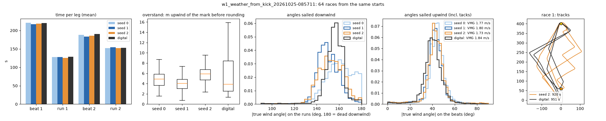

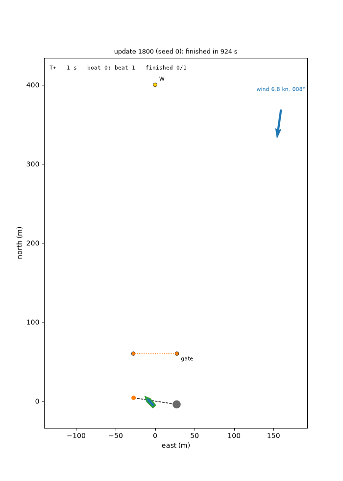

### 5.3 Why weather racers did not finish: strong current in light wind

Averaged over finished races only, W1 and W3 looked faster than the digital racer. With DNFs scored as the
time limit they were level: they won 53–69% of races and lost ~15 minutes on each race they did not finish.

All six weather policies (W1, W3 × 3 seeds) raced 256 starts with the wind at the boat logged
(`experiments/weather_failures/`). 15 races beat ≥ 4 of the 6 policies, so it is the
**conditions**, not the seeds. The one clear signal was the current (0.41 vs 0.24 m/s in failing vs
finishing races; separates the groups 83% of the time), together with lighter wind. Gusts, lulls, shifts
and waves made no difference.

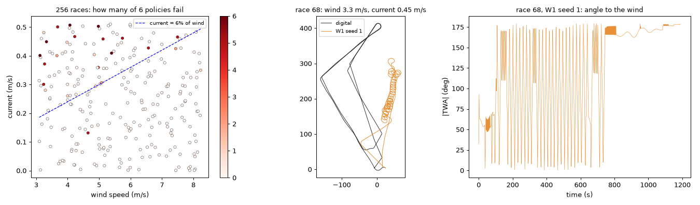

- Current > 8% of the wind speed: **24%** of races failed; elsewhere 3%.
- A stuck boat keeps its speed through the water but tacks every ~20 s, makes no ground against the
  current, drifts back down the course and circles until the time limit (heading changes ~14°/s).
- The digital racer finishes the same races in ~700 s.

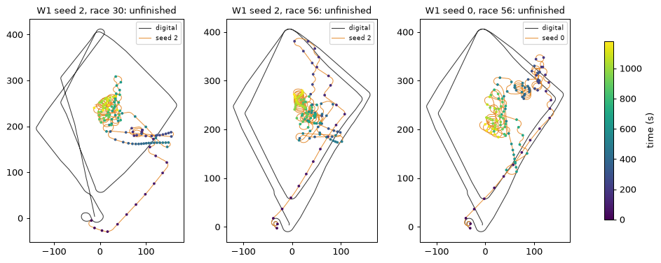

### 5.4 The race committee rule

Real race officers do not start a race in a current the fleet cannot sail against. sail_env got
`current_max_frac` (off by default): the current is drawn uniformly in [0, min(current_max, frac × TWS)].
We use 0.06. Scored again under this rule (no retraining), W1 and W3 finish 97–99% and are still level with
the digital racer (−1 to +5 s).

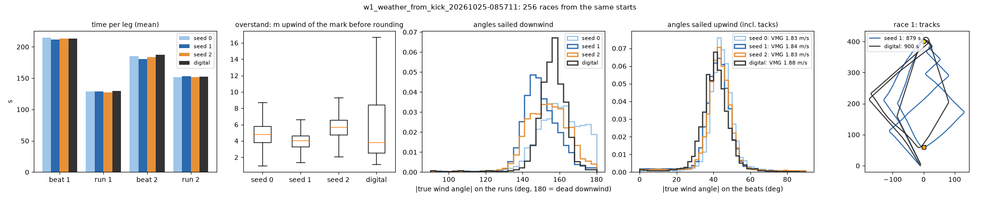

### 5.5 W4: retrained under the rule

`w4_capped_from_w1.yaml`: W1 plus `current_max_frac: 0.06`, lr 1e-4 (fine-tuning), 30M steps. The laptop
session restart killed it at update 800; it was finished on the GPU from its checkpoint at the same 64
envs (`gpu_w4_resume.yaml`). Result on 256 races: finished 98–99%, fair score −0.2 / −3.0 / **−7.8** s
(only seed 2 clearly faster). The success bar (> 99% finished and clearly faster) was not met.

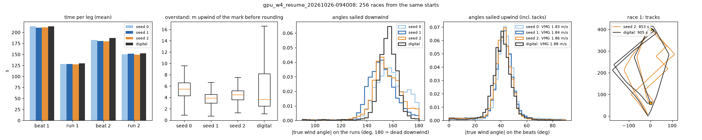

---

## 6. Scale: one rented GPU (2026-10-26)

### 6.1 Throughput

Everything (environment, all boats, PPO) is one compiled JAX program, so a GPU can run thousands of races at
once. `experiments/bench_throughput.py` times training (compile excluded) on the laptop CPU and on an
RTX 4090 (Runpod):

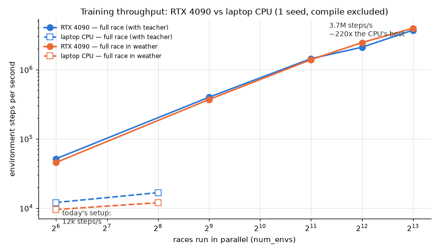

| Parallel races | Laptop CPU | RTX 4090 |
|---|---|---|
| 64 (the laptop setup) | 12,000 steps/s | 51,000 |
| 256 | 16,700 | – |
| 2048 | – | 1,433,000 |
| 8192 | – | 3,700,000 (~220× the CPU's best) |

At 64 envs the GPU is mostly idle (a 16-core pod CPU kept pace with it); the speed comes from width.

### 6.2 Does wide training still learn? (gpu_s4k_2048)

The kickstarted stage 4 again, with 2048 envs × 64 steps (batch 131k, 8× the laptop's), 32 minibatches,
200M steps per seed (5× the laptop's samples, 1530 updates). **23 minutes.** Fair score
**−7.9 / −11.0 / −3.0 s**, all three seeds clearly faster than the digital racer, 100% finished, seed 1
winning 91% of races. Bigger batches did not hurt. This network is the bundled `rl-racer`.

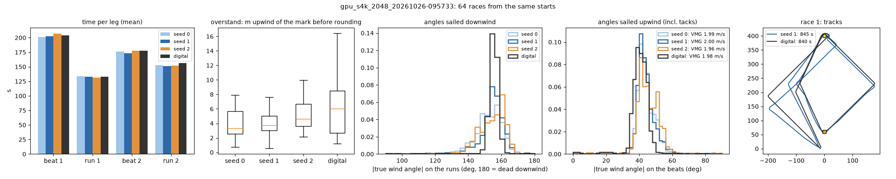

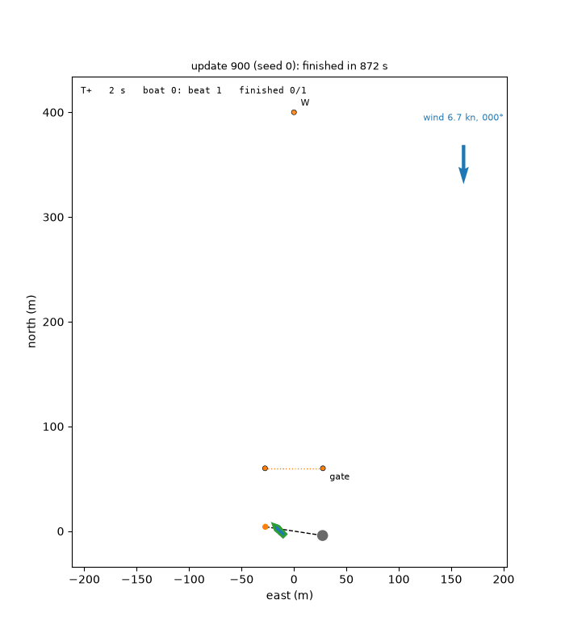

### 6.3 W5: weather at scale

Both with 2048 envs, 200M steps per seed, current capped at 6% of the wind:

| Run | From | lr, entropy | Finished | Fair score vs digital |
|---|---|---|---|---|
| W5a | W4 | 1e-4, 0.004 → 0.002 | 100% (64 races) | −14.5 / −15.7 / −15.7 s |
| **W5b** | GPU kickstarted racer (widened) | 3e-4, 0.01 → 0.002 | 100% (1 DNF in 768) | **−19.2 / −14.7 / −14.9 s** (256 races) |

W5b wins 87–93% of races. It is faster on every leg, mostly on the beats: it sails as close to the wind as
the digital racer and still makes more ground towards it (VMG 1.92–1.94 vs 1.88 m/s), i.e. it uses the
shifts and puffs the digital racer cannot anticipate. It overstands less and more consistently (median
3.5–4.4 m). It also sails the runs higher than the digital racer (~150° vs ~157°).

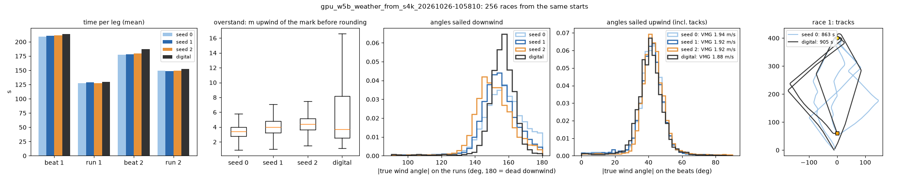

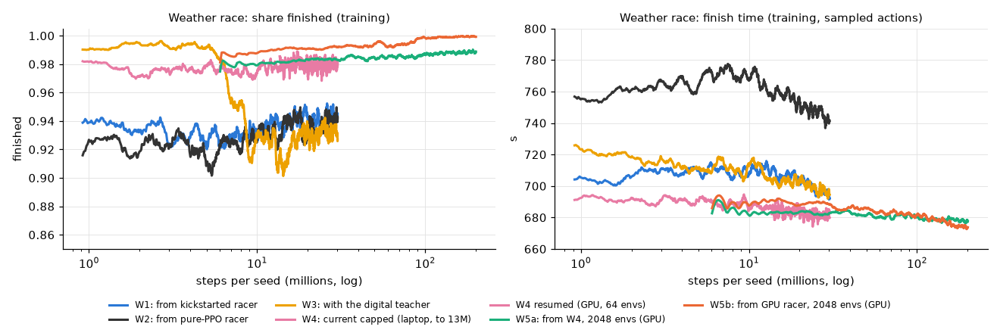

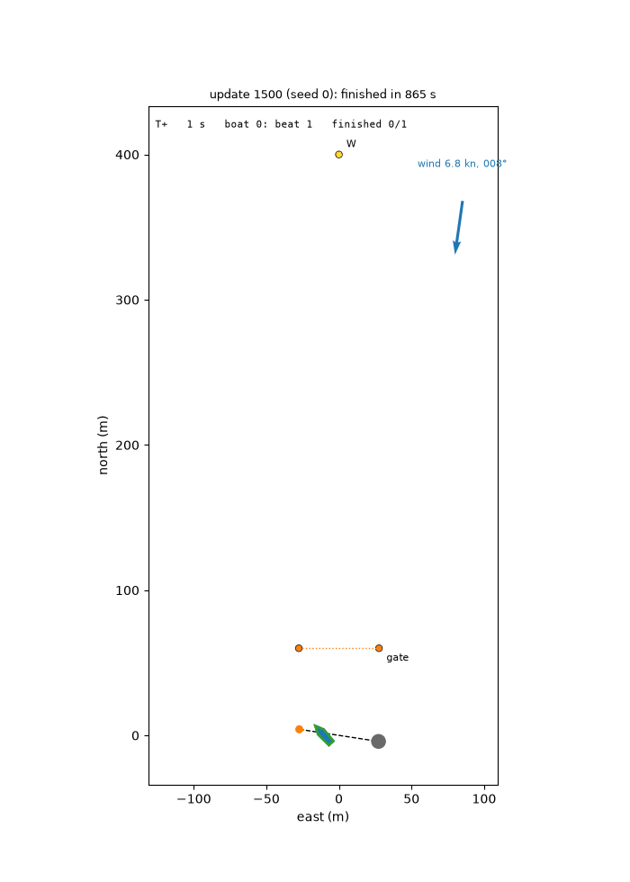

**The deciding factor was scale, not a new method:** the same training that left W1 level with the
digital racer pulled clearly ahead with 2048 races in parallel and 200M steps.

### 6.4 The gate rule fix (2026-10-26)

GIFs of the first fleet runs showed boats crossing the leeward gate between the marks and sailing straight
on: the rule counted that as completing the run. A real gate must be rounded: through, then back up round
the outside of one mark. sail-env 0.2.0 fixes it in the Python and browser simulators, and the digital
racer now rounds a gate mark too. The two racers were retrained under the fixed rule on the GPU (configs
`gpu/gpu_racer_gate.yaml`, then `gpu/gpu_weather_gate.yaml` from it), 64 test races each, paired with the
digital racer:

| Racer | Conditions | Paired difference to the digital racer, seeds 0 / 1 / 2 | Faster in |
|---|---|---|---|
| gpu_racer_gate (bundled `rl-racer`) | steady | −24.1 / −21.6 / −20.7 s | 100% of races |
| gpu_weather_gate (bundled `rl-racer-weather`) | weather | −28.3 / −27.8 / −25.6 s | 91–97% |

The gaps are larger than before the fix because the digital racer's gate rounding is slow; a tighter rounding
for it was tried and was slower overall, so it was reverted. Part of these margins is the digital racer's
weakness at the gate, not the learned racers' skill.

**TODO:** does W5b actually read the wind upwind? An ablation (zeroing the 6 look-upwind inputs, or the
wind history) would show which weather inputs it uses.

---

## 7. Engineering notes (what went wrong and what fixed it)

- **Checkpoints:** every 100 updates (`params.msgpack`, `checkpoint.txt`). A crash or restart resumes with
  a config that continues the schedules (lr and entropy at the fraction reached; Adam restarts).
- **Windows Application Control** on the laptop twice killed every process (once mid-run); unsigned binaries
  (e.g. `runpodctl`) cannot run. File transfer to pods uses Windows' own `ssh`/`scp`.
- **Runpod:**
  - A stopped pod can only restart on the same machine; twice in one day its GPU had been rented out.
    Copy results back, then terminate; a new pod is set up in ~2 minutes (`experiments/runpod/`).
  - Editing a pod's environment restarts its container (kills jobs, new SSH port and host key).
  - Upload speed differs by host: one US host gave 45 KB/s, EU-RO-1 ~1 MB/s.
  - W&B: put the key in a Runpod secret (`WANDB_API_KEY={{ RUNPOD_SECRET_WANDB_API_KEY }}`); start jobs with
    `run_queue.sh`, which loads only the `WANDB_*` variables (sourcing the whole pod environment resets
    library paths and JAX silently falls back to the CPU) and keeps W&B's folder off the network drive
    (there its sender stalled after the first GIF; `wandb sync --no-skip-online` re-pushed the run).
  - Cost: the GPU work on 2026-10-26 (benchmark, W4 resume, gpu_s4k_2048, W5a, W5b) was ~$2.50 at
    $0.89/h for an RTX 4090.

---

## 8. Reproduce

```sh
# steady wind: ladder stages 1-3, then the kickstarted stage 4
python experiments/ladder.py experiments/configs/ladder/s1_beat100.yaml experiments/configs/ladder/s2_beat400.yaml \
    experiments/configs/ladder/s3_beat_run.yaml
python experiments/queue.py experiments/configs/gpu/gpu_s4k_2048.yaml:runs/train/<stage-3 run>   # GPU; s4k_full_kick.yaml on a CPU

# weather at scale, from that racer
python experiments/queue.py experiments/configs/gpu/gpu_w5b_weather_from_s4k.yaml               # init_from in the config

# judge any run against the digital racer (fair score, leg times, figure)
python experiments/diagnose_race.py runs/train/<run> --races 256 --steps 1250

# the figures in this document
python experiments/make_writeup_figures.py
```

On a Runpod GPU: `experiments/runpod/README.md` (pack, upload, `setup.sh`, `run_queue.sh`).

The two best racers are bundled in sail-env: `load_agent("rl-racer")` and
`load_agent("rl-racer-weather")`.

## 9. Runs

| Run (runs/train/…) | What | W&B |
|---|---|---|
| race_a_shaped_20261021-* | agent A | nick0eyr |
| race_b_uniform_20261023-162653, race_b_sfl_* | agent B | 1ia0yhoo (SFL) |
| ladder_s1_beat100_20261024-095647 … ladder_s4_full_20261024-170950 | ladder stages 1–4 | |
| ladder_s4k_full_kick_20261024-212058, ladder_s4k_resume_20261025-073036 | kickstarted stage 4 | |
| a1_kick_from_scratch_20261025-132443 | kickstarted from scratch | |
| w1/w2/w3_* (2026-10-25), w4_capped_from_w1_20261026-080754 | weather on the laptop | |
| gpu_w4_resume_20261026-094008 | W4 finished on the GPU | mz32se55 |
| gpu_s4k_2048_20261026-095733 | kickstarted, 2048 envs | flld7zrx |
| gpu_w5a_weather_from_w4_20261026-103537 | W5a | 5t0iyicc |
| gpu_w5b_weather_from_s4k_20261026-105810 | W5b | xn0iqfjn |

All in the W&B project `sailstart`. **TODO:** fill in the missing W&B ids.

## 10. Open questions (TODO)

- Which weather inputs does W5b use (ablation)?
- More seeds (5–10) and baselines (behaviour cloning alone; BC then RL; other kick schedules) for a paper.
- A literature check: RL for sailing exists (MERL 2022 upwind sailing in variable wind; Team New Zealand's
  RL sailor; sim-to-real Optimist), but no work found on learned fleet or team racing.
- Fleet and team racing (4 boats, 2v2): done, see [writeup_fleet_team.md](writeup_fleet_team.md).
