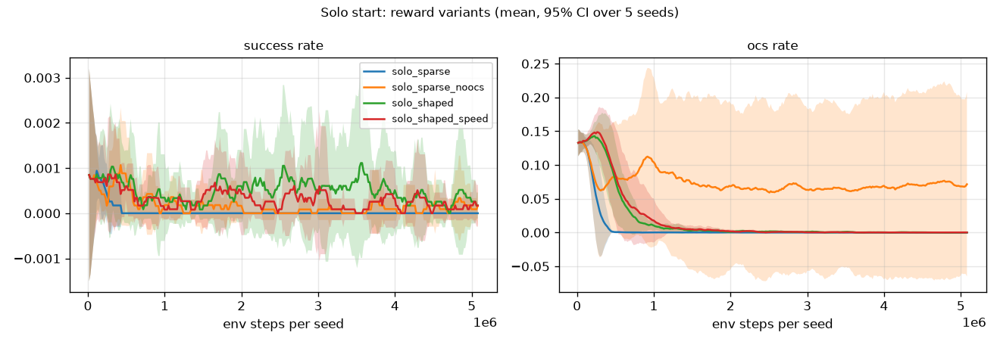
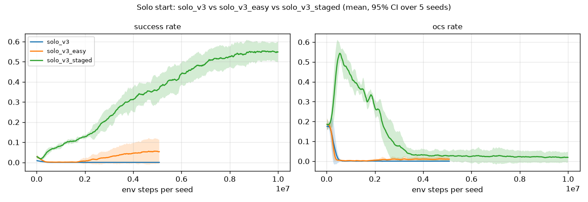
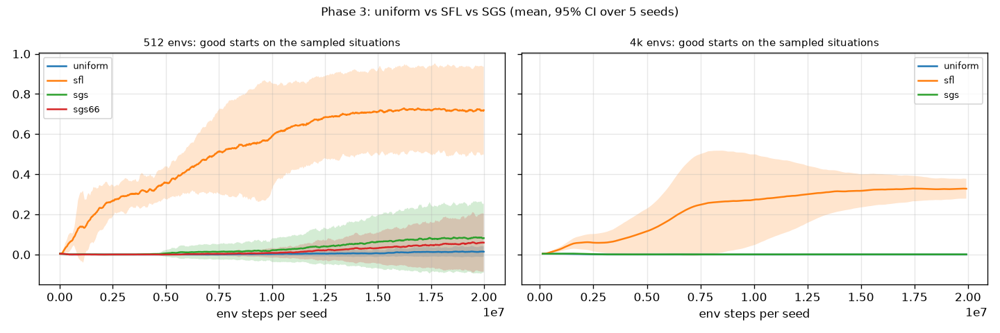
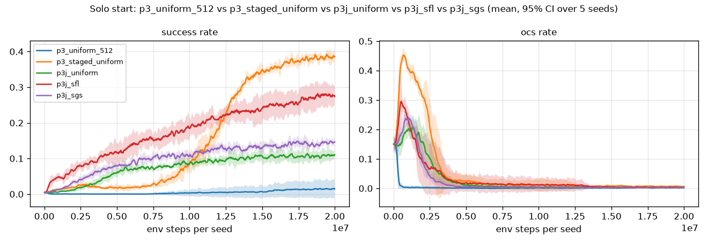
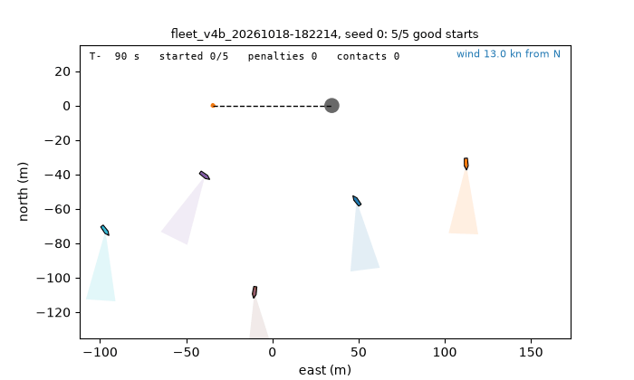

# Teaching a J/70 to start: reinforcement learning on a sailing start line

> **DRAFT** (2026-10-21). Numbers come from the runs' evaluations; items marked **TODO** are
> decisions or checks still open.

## The problem

A sailing race begins with a start sequence. When the gun fires, every boat wants to be *on* the start
line, at full speed, on starboard tack (which gives it right of way), in clean air, and not over the
line early. Over early is "OCS": the boat must turn back and restart. Being early costs everything;
being late or slow costs the race. Doing this well is mostly timing: judging time-to-line from distance,
speed and the boat's acceleration, with no instrument that shows it.

This project asks how far reinforcement learning can get on that task, from one boat alone to a fleet
of five, and which training choices matter.

**TODO:** one paragraph on why this is interesting beyond sailing: sparse, timing-critical success; a
long lag between action and outcome; interaction governed by rules.

## The simulator

Everything runs on [sail_env](https://github.com/tringermate/sail-env), a JAX simulator written for this
project (2D, one decision per second, jit- and vmap-compatible, ~200k boat-steps/s on a laptop CPU):

- **Boat:** the J/70 polar from ORC certificate data. Speed relaxes towards the polar with a lag, and
  slows by a force balance of hull drag and windage. Turning is limited by speed; tacks and gybes cost
  speed; luffing (easing the sails) holds position.
- **Rules:** start line with OCS and individual recall. In the fleet: right of way (RRS 10–13), capsule
  contacts, penalty turns, solid marks, and wind shadow along each boat's apparent wind.
- **Actions:** 7 discrete. Hold, head up or bear away by 5° or 15°, tack/gybe, luff.
- **Observation:** in the boat's own frame. Speed, TWA, clock, line ends, distance to the line, bias,
  wind speed, and the 5 nearest boats. No time-to-line instrument.

**A good start** (the success measure throughout) means: at the gun, the bow is 0–3 m below the line
and between its ends; the boat then crosses within 3 s at ≥ 90% of polar speed, on starboard. In the
fleet it must also be in clear air at T+10 and owe no penalty.

## The learner

PPO, written from scratch in one commented file in the PureJaxRL style. The whole rollout and update
compile under jit, and 5 seeds train in parallel with vmap. It was checked on CartPole first (all 5
seeds solve it in ~1 minute). Results are reported over 5 seeds with 95% confidence intervals, using
the most likely action on standard starts.

## Part 1: one boat (Phase 2)

| Step | Good starts | Lesson |
|---|---|---|
| Sparse reward (+1 success, −1 OCS) | 0% | OCS (−1) is far more common early on than success (+1): the boat learns to stay away from the line |
| + potential-based shaping | 0% | Shaping adds the same total to every episode, so it cannot make approaching better than parking. The critic learns it and it cancels out of the advantages |
| + easier starts in the mix | 2% | Success becomes frequent enough to learn from |
| + **staged rules** (succeed first, then tighten) | 27% | All 5 seeds learn |
| + starboard required + height after the start | 63% | One clear strategy is easier to learn |
| + per-second starboard bonus | 44% ± 44% | Gamed by 2 seeds (park on starboard, luffing): per-step bonuses get farmed, and the habit survives removing the bonus |
| Strict "on the line" + 20M steps | 87% | Training time was the bottleneck |
| + height per second capped at the polar, drag physics | **87% ± 10%** | Boats now sail close-hauled after the start instead of shooting head to wind |





Where the final policy still fails ([failure map](figures/failure_map_run_d.png)): mostly **late**; the
hardest starts are those very close to the line, on the pin side, and in light air far away.

## Part 2: curricula, choosing what to practise (Phase 3)

Success-Guided Sampling (SGS; Zhang et al., CoRL 2026) chooses which starting situations to train on,
favouring those the policy succeeds on sometimes but not always. Here it is compared with uniform
sampling and Sampling for Learnability (SFL, weight p(1 − p)), over 4,096 fixed situations, with the
strict success rule from the start:

| Good starts | 512 envs |
|---|---|
| Hand-made staged rules (Part 1) | **86.6%** |
| Uniform | 1.5% |
| SFL | 35.6% ± 41% |
| SGS (paper defaults) | 3.3% |



With the staged rules underneath, the sampler no longer matters: staged rules + uniform reach
**89.2% ± 3.1%** (the best solo policy), and staged rules + SGS 86.2% ± 7.9%. A joint curriculum over
(situation, rule level) recovers ~75–80% of the hand-made schedule without any tuning (68–74%), and
SGS again equals uniform.



**Finding:** for a sparse, timing-critical task, a curriculum over *what counts as success* matters far
more than a curriculum over *which situations to practise*. SGS's "balanced diet" is designed for
policies that already succeed sometimes; the staged rules are what get them there.

## Part 3: five boats (Phase 4)

One shared policy sails all five boats (self-play), warm-started from the solo policy.

- **The solo policy dropped into the fleet: 2% good starts.** Every boat aims for the same spot.
- After fleet training: **73%**. The boats spread out, reach towards the committee end on port, tack
  ~30 s before the gun and approach in a staggered line, each out of its neighbours' wind shadow.
- Making contact cost reward (RRS 14) and ranking the boats by height at T+10: **82%**, with far fewer
  contacts. Apparent-wind shadow and a stiffer contact cost: **90%** good starts, 0.14 contacts per boat.
- **Competition comes from crowding, not ranking:** a stronger ranking reward barely changes behaviour,
  while a shorter line (≈ 9 m per boat) makes starts truly contested. Good starts drop to 61%, with
  more contacts and boats pushed over early.
- With wind shifts (±5°) and line bias (±10°): **68%**.



**Hand-written baselines for scale:** a "time on distance" controller reaches 20% (solo) and 9% (fleet).
The same controller, allowed to try 40 settings per start in the simulator (it knows the future),
reaches 78%. The RL policy (89%) beats both.

## What I'd take away

1. **Reward design dominated everything.** Every failure in Part 1 was the agent doing exactly what the
   reward said: parking, farming per-step bonuses, shooting head to wind.
2. **Potential-based shaping is safe but toothless here:** it cannot change which policy is best, and
   in this task that was exactly the problem.
3. **Curricula over the success criterion beat curricula over situations.**
4. **In the fleet, the geometry (line length per boat) creates the competition,** more than the reward.

**TODO (decide):**
- **Phase 5 (penalty flags I, Z, U/black):** run it as the headline experiment, or drop it from the write-up?
- **One evaluation protocol for all numbers:** re-evaluate every policy on the sail_env presets with the
  same seeds. Some numbers here (e.g. solo 89.2%) come from earlier evaluation sets; the sail_env
  baselines report 86.5% for the bundled solo policy.
- **Venue:** README section, blog post, or a short paper? That changes how much of the ablation detail stays.

## Reproduce

```sh
git clone https://github.com/tringermate/sail-env && git clone https://github.com/tringermate/sail-rl
cd sail-rl && uv sync
uv run python -m sail_env.train.run experiments/configs/p3_staged_uniform.yaml   # best solo policy
```

The results were produced with an earlier version of the simulator, since merged into sail-env; for the
start tasks sail-env behaves the same with the weather switched off.
